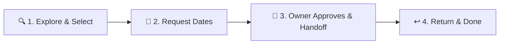

# 🏡 ShareNest — Local Peer-to-Peer Rental & Sharing Platform

<div align="center">

> *"Don't buy what you can borrow. Share more. Spend less. Live sustainably."*

[](https://sharenest-i7zv.onrender.com)
[](https://www.mongodb.com/cloud/atlas)
[](https://vitejs.dev/)
[](https://expressjs.com/)

**[🌐 Visit Live Website: https://sharenest-i7zv.onrender.com](https://sharenest-i7zv.onrender.com)**

</div>

---

## 💡 The ShareNest Story

Have you ever spent **₹4,000 on an impact drill** just to hang two picture frames? Or **₹60,000 on a DSLR camera** that gathers dust 360 days a year? 

**ShareNest** fixes that. 

ShareNest is a neighborhood sharing marketplace connecting neighbors across **Indore, Ujjain, and Dewas** to rent, borrow, and lend everyday items safely. Borrow a GoPro for your weekend getaway, rent a scientific calculator for your semester exams, or list your unused power tools to earn passive income!

---

## 🔄 How It Works

ShareNest simplifies neighborhood rentals through a transparent, 4-step handover lifecycle:



### 🙋 For Borrowers:
1. **Discover**: Browse categories (Cameras, Electronics, Tools, Books, Camping Gear) or search by your city.
2. **Book**: Pick your pickup and return dates. See the transparent daily rental rate (e.g. ₹50/day) and refundable deposit.
3. **Pick Up**: Meet your neighbor, confirm receipt with one tap on your dashboard, and enjoy the item.
4. **Return**: Return the item on your scheduled date and get your deposit released!

### 📦 For Lenders:
1. **List in 60 Seconds**: Snap a photo, set your daily fee (₹) and security deposit, and publish your listing.
2. **Review Requests**: Accept or decline incoming booking requests from verified community members.
3. **Handover & Earn**: Mark the item as handed over when the borrower arrives.
4. **Inspect & Complete**: Confirm return upon receiving your item back in original condition.

---

## ✨ Key Features

- 📍 **Hyper-Local Discovery**: Filter items instantly across **Indore**, **Ujjain**, and **Dewas**.
- ⏱️ **True Rental State Machine**: Enforces secure transitions:
  `Requested` ➔ `Approved` ➔ `Handed Over` ➔ `Received` ➔ `Returned` ➔ `Completed`.
- 💰 **Transparent Indian Rupee (₹) Pricing**: Clear daily rental rates and refundable deposits. No hidden platform cuts.
- 🔐 **Dual Role Auth & Session Management**: Switch between Borrower and Lender roles with JWT authentication and secure passwords.
- 📱 **Mobile-First Responsive Design**: Clean, modern interface designed with Tailwind CSS and Lucide icons.
- 🚀 **High-Performance Monorepo Architecture**: Express serves the compiled React Vite SPA in production on a single Render instance with zero CORS issues!

---

## 🛠️ Tech Stack

| Layer | Technologies |
| :--- | :--- |
| **Frontend** | React 18, Vite, React Router v6, Tailwind CSS, Lucide Icons, React Hot Toast |
| **Backend** | Node.js, Express, Helmet, CORS, Morgan, Express Rate Limit |
| **Database** | MongoDB Atlas (Cloud Database with Mongoose ODM) |
| **Authentication** | JSON Web Tokens (JWT) + Bcrypt password hashing |
| **Deployment** | Render (Unified Full-Stack Web Service) |

---

## 👥 Instant Test Accounts

You can test the live platform immediately using these credentials:

| Role | Email | Password | City |
| :--- | :--- | :--- | :--- |
| **Lender / Owner** | `naman@sharenest.com` | `Password@123` | Indore |
| **Borrower** | *Click "Sign up for free" to create your own account instantly!* | (Any) | Any |

---

## 💻 Local Development Setup

To run ShareNest locally on your machine:

```bash
# 1. Clone the repository
git clone https://github.com/naman0412/ShareNest.git
cd ShareNest

# 2. Install dependencies for both client and server
npm run build

# 3. Start local development (runs Express on :5000 and Vite on :5173)
npm run dev
```

- Frontend URL: `http://localhost:5173`
- Backend API: `http://localhost:5000/api`
- Health check: `http://localhost:5000/api/health`

---

## 🌍 Cloud Deployment (Render + MongoDB Atlas)

ShareNest is pre-configured with a Render blueprint (`render.yaml`).

1. **Database**: Create a free **M0 cluster** on [MongoDB Atlas](https://www.mongodb.com/cloud/atlas) and allow access from `0.0.0.0/0`.
2. **Render Web Service**:
   - Build Command: `npm run build`
   - Start Command: `npm start`
   - Environment Variables:
     - `NODE_ENV`: `production`
     - `MONGODB_URI`: `mongodb+srv://<username>:<password>@cluster0.xxx.mongodb.net/sharenest?retryWrites=true&w=majority`
     - `JWT_SECRET`: `your_random_secret_key`

---

<div align="center">
  <sub>Built with ❤️ for sustainable community sharing.</sub>
</div>
